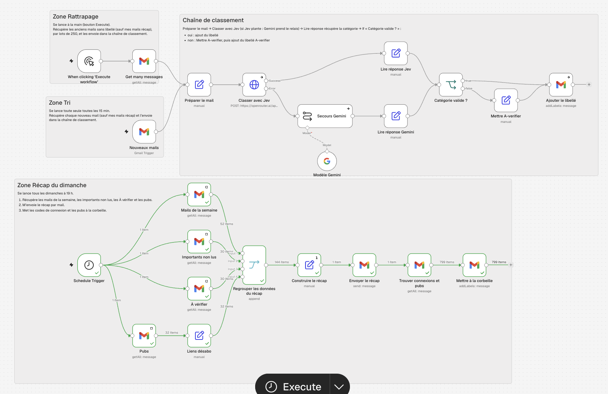
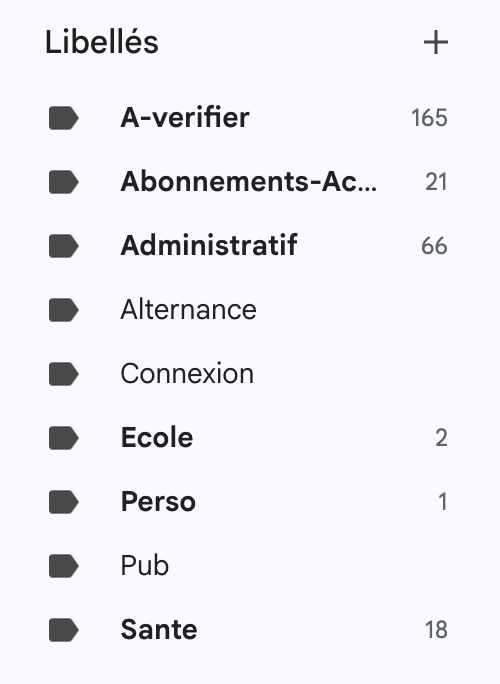

# Projet n8n : tri automatique de ma boîte Gmail

Projet de Margot Frappa (École Eugenia). Un workflow n8n qui trie ma boîte Gmail personnelle grâce à une IA, géré comme du code avec `n8ncli`, et trois skills pour Claude Code qui encadrent la façon de construire un workflow.

## Sommaire

1. [Vidéo de démo](#vidéo-de-démo)
2. [Objectif du workflow](#objectif-du-workflow)
3. [Architecture et grandes étapes](#architecture-et-grandes-étapes)
4. [Captures du workflow](#captures-du-workflow)
5. [Commandes n8ncli](#commandes-n8ncli)
6. [Les 3 skills](#les-3-skills)
7. [Contenu du repo](#contenu-du-repo)
8. [Feedback du cours](#feedback-du-cours)

## Vidéo de démo

- **Vidéo** : [`video/video_n8n-compresse.mp4`](video/video_n8n-compresse.mp4) (9 min 55 s, 21 Mo)
- **Transcription** : [`video/transcript.md`](video/transcript.md)

La vidéo présente le workflow, puis les commandes n8ncli dans le terminal, et se termine par mon feedback sur le cours.

## Objectif du workflow

Trier automatiquement les mails de ma boîte Gmail personnelle : chaque mail reçoit un libellé grâce à une IA, et je reçois chaque dimanche un récap de la semaine.

- **Entrée** : les mails qui arrivent dans ma boîte Gmail (nœud « Nouveaux mails »), et les anciens mails sans libellé (rattrapage manuel).
- **Sortie** : chaque mail a un libellé (Perso, Santé, Administratif, Abonnements-Achats, Ecole, Alternance, Connexion, Pub, ou A-verifier), et un mail de récap m'est envoyé chaque dimanche.

## Architecture et grandes étapes

Le workflow est un seul fichier, découpé en deux parties.

**1. Le tri des mails**
- Un déclencheur toutes les 15 minutes pour les nouveaux mails, et un rattrapage manuel (par lots de 250) pour les anciens.
- Chaque mail est classé par l'IA principale, **Jev 1.14** via OpenRouter.
- Si Jev échoue, **Gemini** prend le relais (secours configuré).
- Si la catégorie n'est pas valide ou si la confiance est trop basse, le mail part dans **A-verifier**.

**2. Le récap du dimanche**
- Déclenché chaque dimanche à 19 h.
- Récupère les mails de la semaine, les importants non lus, les mails à vérifier et les pubs avec leurs liens de désabonnement.
- Construit le récap et me l'envoie par mail.
- Met à la corbeille les pubs et les codes de connexion. Les mails Santé, Administratif et Alternance ne sont jamais supprimés.

Le détail est dans la sticky note « Specs » du workflow, et dans [`workflow/`](workflow/).

## Captures du workflow

**Vue d'ensemble du workflow** (les trois zones : rattrapage, tri, récap du dimanche) :



**Libellés Gmail après l'exécution** (les libellés Pub et Connexion sont vides, car les pubs et les codes de connexion ont été mis à la corbeille) :



## Commandes n8ncli

[`n8ncli`](https://github.com/Workflows-Accelerator/n8n-cli) (paquet `@workflows-accelerator/n8n-cli`) fait le lien entre mon instance n8n et des fichiers TypeScript sur mon ordinateur.

| Commande | Rôle |
|---|---|
| `n8ncli envs list` | Liste les instances n8n configurées. |
| `n8ncli env test` | Vérifie les connexions (le serveur MCP répond). |
| `n8ncli status` | Compare mes fichiers locaux à la dernière synchronisation. |
| `n8ncli folders list` | Liste les dossiers du projet dans n8n. |
| `n8ncli validate "<fichier>"` | Vérifie que le fichier respecte le schéma des nœuds n8n. |
| `n8ncli diff "<fichier>"` | Compare le fichier local à la version dans n8n. |
| `n8ncli pull` | Récupère les workflows depuis n8n en fichiers `.workflow.ts`. |
| `n8ncli push --dry-run "<fichier>"` | Simule un envoi vers n8n, sans rien modifier. |
| `n8ncli push "<fichier>"` | Envoie les modifications vers n8n. |

Exemple :

```bash
n8ncli validate "workflow/Tri Gmail et Récap Hebdomadaire.workflow.ts"
```

## Les 3 skills

Les skills sont dans [`skills/`](skills/). Ensemble, elles couvrent tout le cycle de construction d'un workflow :

| Skill | Phase | Rôle |
|---|---|---|
| [`interview`](skills/interview/SKILL.md) | Avant (10 %) | Interroge sur l'idée, challenge le besoin, propose des simplifications et rédige une spec à valider. Rien n'est construit sans validation. |
| [`doubt-driven-dev`](skills/doubt-driven-dev/SKILL.md) | Pendant (80 %) | Construit en doutant de chaque hypothèse : tests écrits avant le code, seule une exécution vaut preuve, vérification dosée selon le risque. |
| [`hostile-review`](skills/hostile-review/SKILL.md) | Après (10 %) | Relit le travail en adversaire, en lecture seule, et rend un verdict avec des défauts démontrés. |

Chaque skill a un fichier `references/n8n.md` avec les questions, sondes et pièges propres à n8n.

Pour installer les skills dans son projet :

```bash
cp -R skills/* .claude/skills/      # Claude Code
cp -R skills/* .agents/skills/      # OpenCode
```

## Contenu du repo

| Dossier / fichier | Contenu |
|---|---|
| `README.md` | Ce document : le rendu complet. |
| [`workflow/`](workflow/) | Le workflow n8n au format TypeScript (`.workflow.ts`). |
| [`skills/`](skills/) | Les 3 skills : `interview`, `doubt-driven-dev`, `hostile-review`. |
| [`video/`](video/) | La vidéo compressée et sa transcription. |

## Feedback du cours

Mon feedback sur le cours est à la fin de la vidéo, et il est aussi transcrit dans [`video/transcript.md`](video/transcript.md).

## Auteure

Margot Frappa, École Eugenia.
